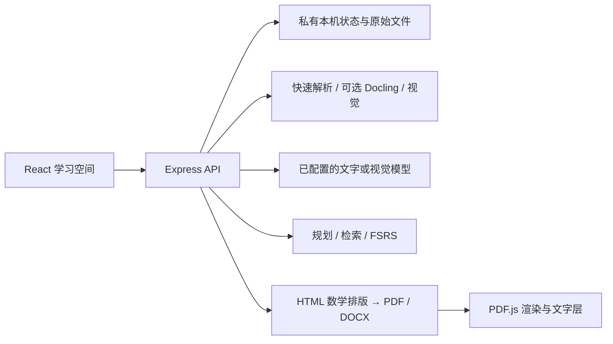

# 架构与算法

## 运行结构

浏览器运行 React/TypeScript；Express 提供同源 `/api` 和生产 `dist`。开发时 Vite 代理 API。没有独立数据库，主学习状态与原件存于本机数据目录。正式启动启用多账户认证，通过 `server/workspaces.mjs` 按账户分配独立数据目录；测试工厂 `createApp()` 可在隔离目录内不启用认证，不能直接作为公网生产入口。

## 资料归科

`parsers.mjs` 保留页/段位置；`classify.mjs` 使用文件名和多条学科关键词；`ai-classify.mjs` 在有连接时发送正文的均匀抽样和已有课程名。新学科需多条不重叠原文证据。校验模型引文是否是实际样本，冲突/混科返回人工确认；模型不可用时明确退回本地规则。文件 SHA-256 去重与课程名复用避免简单重复。

这不是经过大学课程分类测试集标定的分类模型。引用真实只能说明有出处，不能证明学科判断正确；不应将固定置信值当校准概率。

## 课程工作台

`course-studio.mjs` 将所选资料拆为可追溯来源单元，按字符预算分批提取、组织章节和合并。覆盖校验发现遗漏时，只对遗漏单元补读一次；修复仍不完整则不提交假完整产物。最终产物、课程文档与助手消息一起保存，保存失败回滚。文档指纹用于防止处理中来源变化后提交旧结果。

聊天直接检索原文（小资料全部发送，长资料取相关片段），控制上下文预算；上下文不完整时明确标识。修订另存版本，保留旧稿。任务状态有进度、取消与中断恢复；不是支持跨进程自动续跑的持久任务队列。

## 复习规划

`planner.mjs` 实现滚动时间范围内的确定性启发式：根据考试截止、准备起点、剩余工作量、当前掌握估计、目标、难度、到期记忆与模考薄弱点计算边际分配，检查截止日前缀的容量瓶颈，再按空闲窗口装入专注段、休息与缓冲。

时间线受具体时段容量约束；按天模式只要求完成当天总任务。每日预算与实际可放入时段的容量分别核算。完成记录保存原快照，后续改偏好不会改写历史；剩余小时手动修改会重新建立计算基线。日期使用 Asia/Shanghai。工作量不足/时间不足/未设考试日期都有明确状态。

它不是 MILP/CP-SAT 求解器，没有全局最优或“保证提分”的证明。自动工作量是排期估计，允许用户覆盖。测试验证容量、时间窗、历史与截止等约束，不验证现实学习效果。

## 检索与记忆

`engine.mjs` 的本地分词/词项统计检索为课程答疑筛选相关原文，不是完整向量数据库或重排服务。工作台聊天在预算内复用检索。

间隔复习实际调用 `ts-fsrs`；四档自评更新卡片状态与到期时间，请保留依赖归属。掌握估计是学习产品内部统计，不等于考试分数或客观能力测量。

## 出题、整组讲评与模考

理解题先生成蓝图再生成完整题目。题型/数量/答案契约保存在服务端；`evidence.mjs` 提供服务端截出的逐字引用候选 ID，模型只需选择。兼容旧引文时只放宽空白，不改写负号、公式或文字。标题/来源索引不作为单独的解释证据。

`practice-sessions.mjs` 为一组 1–6 题保存不可见答案契约及草稿修订号。整组提交后调用一次讲评，客观核分确定，低可信主观反馈保留待核对。重复/并发提交、过期草稿、来源变化、保存失败都有约束。

`exams.mjs` 保存真题模板，先确认结构再按固定题型/数量/分值生成，整卷校验后原子入库。限时以服务端截止时间为准，离开页面不暂停。草稿版本与独立作答/使用提示的记录分开，交卷幂等；客观参考分、AI 建议分、自评和薄弱点分开保存，不将建议分写成正式成绩。

## 网课精读

链接/字幕或本机语音转写进入时间戳原文；视觉捕获与识别保留帧时间、哈希和图像。知识点和例题提取后可以重编整课，筛选少量可读、相关、条件完整的截图。原文、校对建议、老师内容与 AI 补充保持区分。没有画面时显示缺失状态。

课程问答检索当前讲义、字幕和已识别画面，使用上下文 ID 与指纹检查来源版本；SSE 流式回答附可定位出处。图片相关性与数学结论不能只靠 ID 校验，仍需真实视频样本人工评估。

## 文档阅读

服务端用 Markdown/KaTeX 与受控模板排版，嵌入本地字体及已核对的课程图片；Playwright Chromium 生成真正 PDF。渲染有截止时间、去重和内存缓存。DOCX 是可编辑 OOXML，数学不是整页截图。

浏览器使用 `pdfjs-dist@5.4.296` 的 worker、canvas、TextLayer 显示 PDF；翻页只渲染当前页，支持缩放、可选文字、章节和原文内部链接。这样不依赖浏览器安装原生 PDF 插件。实现参考 [PDF.js 官方示例](https://mozilla.github.io/pdf.js/examples/)，依赖和派生文字层样式按 Apache-2.0 保留许可。

## 保持的工程约束

- 模型输入中的文档/用户文字是不可信内容；不能替换系统契约。
- 不把答案、评分规则、密钥塞入提交前的公共响应。
- 来源修改/删除、课程删除、重置、取消和延迟模型响应不能产生跨课程或过期写入。
- 正式启动启用认证，Vite 的私有目录拒绝规则不能移除。
- 新 UI 行为同时考虑加载、空态、错误、重试、键盘与窄屏。
- 当前持久化面向单进程；多人、分布式任务和数据库改造需重新设计事务与权限边界。
